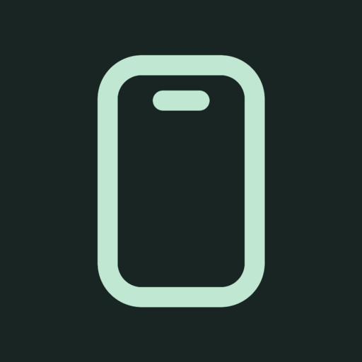
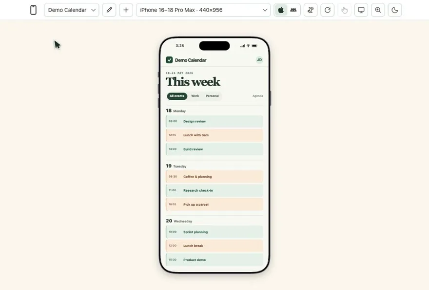

<p align="center">
  
</p>

<h1 align="center">FrameDock</h1>

<p align="center"><strong>Preview your sites in mobile and desktop views, all in one tab.</strong></p>

<p align="center">
  <a href="https://github.com/XternA/framedock/actions/workflows/ci.yml"></a>
  <a href="LICENSE"></a>
  <a href="https://github.com/XternA/framedock/releases/latest"></a>
  <a href="https://github.com/XternA/framedock/pkgs/container/framedock"></a>
</p>

<p align="center">
  <a href="#quick-start">Quick start</a> ·
  <a href="#preview-behaviour">Preview behaviour</a> ·
  <a href="CONTRIBUTING.md">Contribute</a> ·
  <a href="LICENSE">GPL 3.0 Licence</a>
</p>

FrameDock is a lightweight, self-hosted tool for previewing websites, web apps and PWAs. Switch between mobile and desktop views in one tab. See updates live as you save, and demo both views from your browser.

<p align="center">
  
</p>

## Quick start

Run this to start FrameDock in Docker.

```sh
mkdir -p FrameDock && cd FrameDock && curl -fsSL -o compose.yml https://github.com/XternA/framedock/releases/latest/download/compose.yml && docker compose up -d
```

### Manual install

Download [`compose.yml`](https://github.com/XternA/framedock/releases/latest/download/compose.yml), then run this in the folder where you saved it:

```sh
docker compose up -d
```

Open [FrameDock on localhost](http://localhost:9637). Choose **Add project** and enter a port, a host and port, or a full URL.

| Input | Preview target |
| --- | --- |
| `3000` | The host serving FrameDock, on port 3000 |
| `devbox.local:3000` | A dev server identified by its LAN hostname |
| `192.0.2.10:3000` | A dev server identified by its IP address |
| `https://example.com/docs` | A complete URL, including its path |

A shorthand address uses FrameDock’s HTTP or HTTPS scheme. Enter a full URL to specify the scheme explicitly.

If your dev server supports hot reload, changes appear in the preview as you save.

## Update

From your existing FrameDock folder, run:

```sh
docker compose pull && docker compose up -d
```

If you already use a container updater, you can configure it to refresh the FrameDock image automatically.

## LAN access and storage

The default Compose configuration listens on loopback. To access FrameDock from another device on your LAN, bind it to the LAN IP address of the machine running Docker. For an installation on a host at `192.0.2.10`:

```sh
FRAMEDOCK_BIND_IP=192.0.2.10 docker compose up -d
```

| Environment variable | Default | Purpose |
| --- | --- | --- |
| `FRAMEDOCK_BIND_IP` | `127.0.0.1` | Interface for the UI and preview relay |
| `FRAMEDOCK_PORT` | `9637` | Port for the FrameDock UI |

FrameDock can run locally or on a remote development server. Keep FrameDock on a trusted network. Anyone who can open it can access the shared workspace. The `framedock-data` Docker volume stores your saved URLs and preferences. If you delete it, you’ll need to add your URLs and set your preferences again.

Compose also publishes relay ports `9640–9659`, one per relayed site origin. To change the range, set `FRAMEDOCK_RELAY_FIRST_PORT` and `FRAMEDOCK_RELAY_PORTS` (the port count) in the container environment and update the Compose port mapping to match.

## Preview behaviour

- Some sites restrict embedding, sign-in or storage inside previews.
- FrameDock uses your browser’s engine. Use a real device or simulator to check device-specific gestures and installed PWA behaviour.

## Build from source

For local development or contributions, clone the repository and run:

```sh
git clone https://github.com/XternA/framedock.git FrameDock
cd FrameDock
docker compose -f compose.dev.yml up --build -d
```

## Contribute

Bug reports and focused pull requests are welcome. The [contribution guide](CONTRIBUTING.md) covers local builds, browser checks, and reviews.

## Credit and licence

FrameDock was created by XternA and is available under the [GPL 3.0 licence](LICENSE).
